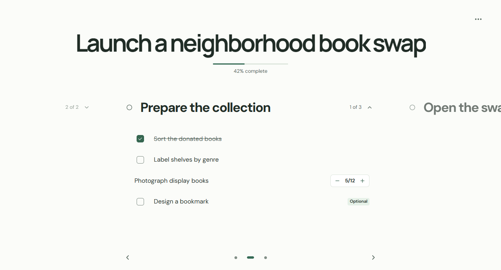

# WhereAmI

WhereAmI is a calm goal and task tracker for Windows and the web. It gives you a place to put the tasks you’re holding in your head and keeps the next step in view while you work.

[Try it in your browser](https://whereami-e6m.pages.dev/) · [Download for Windows](https://github.com/mprestado/WhereAmI/releases/latest)

Create a goal with the centered **+**, then choose how to see the work.

- **Journey** for work that naturally moves from past, through the current objective, toward what comes next.
- **Task list** for objectives that can be handled in any order.

Both layouts use the same simple hierarchy: **Goal or task list → objective → sub-objective**. Optional work stays visible without blocking required progress.



## Get started

The browser app and both Windows x64 installers can save work on your device without an account. The Windows installers are unsigned.

- Choose the **account sync installer** to use the same workspace on Windows and the [hosted web app](https://whereami-e6m.pages.dev/). Sign in with the same WhereAmI account on both.
- Choose the **device-only installer** to keep a workspace local to your PC.

To bring existing tasks into your account, sign in on the device that holds them and open **Account and settings → Workspace data → Copy local workspace to account**. If you want to host your own workspace, see [Supabase setup](#configure-the-shared-backend).

Use the bottom arrows or dots to move between objectives. On a phone, swipe between tiles. Journey advances when you finish the current required objective. Task list keeps the selected tile in place so you can work in any order. Edit titles, optional status, and ordering through **Goal settings → Edit objectives**.

The corner menu holds goal switching, task views, search, account, settings, and JSON export. Press **Ctrl+Shift+Space** in the focused app to capture a task with just a title, or **Ctrl+K** to find something you saved.

On Windows, choose **Task overlay** in the corner menu to keep your checklist above other apps. Use its bottom arrows to move between objectives, drag the header to move the window, and use **Aa** to adjust text size. Closing the main window sends WhereAmI to the notification area and keeps the overlay running. Use the tray icon to reopen the main window or quit.

Choose **Set count target** in a goal item's actions during setup, or use **Goal settings → Edit objectives** later. Set a whole number such as 10. Use **+** and **−** beside the item to update its count.

### Progress rules

Required sub-objectives each count once. A required objective with sub-objectives completes when all required sub-objectives are complete. An objective with no required sub-objectives can be completed manually and counts as one item. Optional objectives and sub-objectives do not add required work or block progress. A new goal with no required work starts at 0%. Task checklists do not get counted again as separate goal work. Journey moves to the first incomplete required objective in its saved order; reopening work recalculates that position. Task list progress uses the same rules without automatically moving the selected tile.

A count target counts as one step at the goal level. It completes when the target is reached and reopens if the count drops. A main objective with its own count target and required sub-objectives completes after both are done.

## Contributing

First-time and returning contributors are welcome. Bug fixes, accessibility improvements, documentation, and platform work all help make WhereAmI easier to use. If you're thinking about a new client or a significant design change, share a short plan in [GitHub Issues](https://github.com/mprestado/WhereAmI/issues) so others can weigh in or help.

1. Fork WhereAmI and create a branch for your change.
2. Keep the change focused and run the [checks](#verification) that apply to it.
3. Open a pull request against `main`. Explain what changed, which platforms you tried, and how you verified it. For visible changes, include a screenshot or short recording.
4. Follow up on review feedback in the same pull request.

If you're new to this workflow, see [GitHub's guide to contributing to a project](https://docs.github.com/en/get-started/exploring-projects-on-github/contributing-to-a-project).

## Next milestone

Bring the same WhereAmI workspace to more devices.

- **Android** with a home-screen widget for seeing the current objective and checking off work without opening the full app.
- **Linux** with a desktop app for everyday planning, quick capture, and progress tracking.
- **macOS** with a desktop app that fits Mac workflows and syncs that same workspace.

Use the tools that fit each platform. Every client should use the [same account, data model, and sync rules](supabase/README.md), including clear saved, pending, and failed states. The [progress rules](#progress-rules) should give the same result on every device, including optional work and count targets.

### Keeping the design consistent

Use the [current app](https://whereami-e6m.pages.dev/), [journey screenshot](docs/whereami-journey.png), and [shared theme values](src/styles.css) as references for color, type, and spacing. Keep the current objective easy to find, secondary controls tucked away, and the same words for goals, objectives, completion, and sync. Use accessible contrast, visible focus, and restrained motion that respects reduced-motion preferences.

Widgets and desktop controls can follow familiar platform patterns while keeping that visual language. When changing a shared color, text style, or interaction, update the shared reference and show how the change looks on the platforms it affects. Include light and dark views when the theme changes.

## Run from source

The web and Windows apps share a React and TypeScript frontend. Tauri provides the desktop windows and tray. IndexedDB stores work locally and queues account edits for optional Supabase sync.

With Node.js 22.12 or newer:

```powershell
git clone https://github.com/mprestado/WhereAmI.git
cd WhereAmI
npm ci
npm run dev
```

Open [the local app](http://127.0.0.1:1420/). See [Windows setup](src-tauri/README.md) for the desktop toolchain.

## Configure the shared backend

1. Create a Supabase project, then follow the [migration and auth setup](supabase/README.md). Apply `202611230002_goal_presentation.sql` for goal layouts and `202611240003_count_trackers.sql` for count targets.
2. Copy `.env.example` to `.env.local`. Set `VITE_SUPABASE_URL` and `VITE_SUPABASE_PUBLISHABLE_KEY` for the same project in both build environments. Keep service credentials in Supabase. Set `VITE_AUTH_REDIRECT_URL` to the allowed web confirmation URL if you need a URL other than the Supabase Site URL.
3. Build and deploy both clients. Create an account, confirm the email in your browser, then sign in on both clients. Add a task in Windows, wait for **Synced**, and confirm it appears on the phone. Repeat in the other direction.
4. If you configure a custom Supabase domain, add its HTTPS and WebSocket origins to the Tauri connect policy in `src-tauri/tauri.conf.json` and the web connect policy in `public/_headers`.

When signed out, the app uses a device workspace. To bring existing work into your account, sign in on the device that holds it, then open **Account and settings → Workspace data → Copy local workspace to account**. Wait for confirmation and check your goals and tasks on a second device signed into the same account. The copy keeps your local records and inserts missing account records. Use the signed-in workspace for subsequent changes you want synced. The cache keeps the confirmed snapshot and pending changes for the account in the current browser profile or WebView2 profile. Clear that profile only after saving or exporting any pending work. Keep the web page open if you need to edit while disconnected. A fresh offline load of the website depends on browser caching. Hosting quotas or downtime can delay cloud confirmation.

## Build and deploy

| Target | Command | Result |
| --- | --- | --- |
| Web | `npm run build` | Static files in `dist/`. |
| Windows development | `npm run tauri -- dev` | Tauri with Vite on port 1420. |
| Windows x64 installer | `npm run tauri -- build` | Current-user NSIS installer in `src-tauri/target/release/bundle/nsis/` with the default Cargo target path. |

Cloudflare Pages can build the source with **npm run build**, output directory **dist**, and the public Vite environment variables above. For direct upload, first build with those variables and upload the contents of `dist/`. Keep the project URL allowlisted in Supabase auth. [Cloudflare Pages build configuration](https://developers.cloudflare.com/pages/configuration/build-configuration/)

Windows builds require a Rust MSVC toolchain, the Microsoft C++ Build Tools and WebView2. See [Tauri's Windows build prerequisites](https://v2.tauri.app/start/prerequisites/).

## Verification

```powershell
npm run check
npm test
npx playwright install chromium
node supabase/sync.integration.mjs
```

To use an installed Chrome browser for the sync test, set `$env:WHEREAMI_BROWSER_CHANNEL = 'chrome'`. The sync test uses two browser sessions, Supabase client calls and PostgreSQL migrations running locally with simulated authentication. Hosted email, Realtime and Windows-to-phone sync need a separate check with a configured backend. The [browser suite](e2e/) includes older tests for layouts superseded by the carousel. See [Windows verification](src-tauri/README.md) for the native smoke test.

See [the refinement plan](REFACTOR_PLAN.md) for model compatibility and progress rules.

## License

WhereAmI is available under the [MIT License](LICENSE). See [font notices](public/licenses/) for the bundled fonts.
